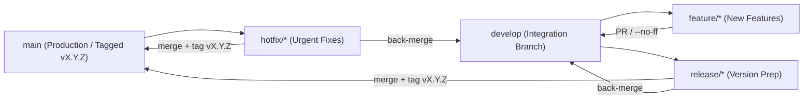

# GitFlow & Automated Tag Release Guide

`LenovoThinkFlow` follows the **GitFlow** branching model paired with **GitHub Actions** automated tag releases.

## 1. Branch Topology



| Branch | Purpose | CI Action |
| :--- | :--- | :--- |
| `main` | Stable production history; every release commit carries an annotated `vX.Y.Z` tag | `.github/workflows/ci.yml` |
| `develop` | Default integration branch for ongoing work | `.github/workflows/ci.yml` |
| `feature/<name>` | Branched from `develop`, merged back into `develop` | `.github/workflows/ci.yml` |
| `release/<X.Y.Z>` | Branched from `develop` to freeze features & bump version, merged into `main` + `develop` | `.github/workflows/ci.yml` |
| `hotfix/<X.Y.Z>` | Branched from `main` for urgent fixes, merged into `main` (tagged) + `develop` | `.github/workflows/ci.yml` |
| Tag `v*.*.*` | Triggers automated macOS compilation, Mach-O kernel symbol audit, ZIP packaging & GitHub Release | `.github/workflows/release.yml` |

---

## 2. Daily Feature Workflow

```bash
# 1. Start a new feature from develop
git checkout develop
git pull origin develop
git checkout -b feature/custom-fan-curve

# 2. Develop, run tests & local kext build
make build
git commit -am "feat(curve): support custom fan hysteresis threshold"

# 3. Merge back to develop (or open a Pull Request -> develop)
git checkout develop
git merge --no-ff feature/custom-fan-curve
git push origin develop
git branch -d feature/custom-fan-curve
```

---

## 3. Creating a New Release (Automated)

### Option A: One-Command GitFlow Release Script (Recommended)

```bash
./scripts/gitflow-release.sh 1.0.2
# or via Makefile:
make release VERSION=1.0.2
```

This script automatically:
1. Creates `release/1.0.2` from `develop`
2. Updates version numbers in `Cargo.toml`, `build.py`, and `ThinkFlow.cpp` and runs `build.py` verification
3. Merges `release/1.0.2` into `main` (`--no-ff`) and creates annotated tag `v1.0.2`
4. Back-merges `main` into `develop` and deletes local `release/1.0.2`
5. Pushes `main`, `develop`, and `v1.0.2` to GitHub — **automatically triggering GitHub Actions to publish the Release**!

### Option B: Direct Tag Push (Quick Tag Release)

Whenever any tag matching `v*.*.*` (e.g., `v1.0.1`, `v1.1.0-rc1`) is pushed:

```bash
git tag -a v1.0.2 -m "Release v1.0.2"
git push origin v1.0.2
```

GitHub Actions (`.github/workflows/release.yml`) will automatically build on macOS and attach:
- `LenovoThinkFlow-vX.Y.Z-macOS.zip` (Full bundle)
- `LenovoThinkFlow-vX.Y.Z-Kext.zip` (Standalone Kext)
- `SSDT-THINKFLOW.aml`
- `thinkflow-macos-universal` (Standalone TUI/CLI executable)
- `SHA256SUMS.txt` + auto-generated Changelog
